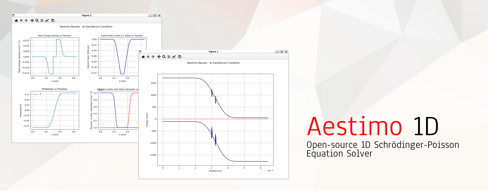

Aestimo 1D
==========

Aestimo simulates one-dimensional semiconductor heterostructures using
Schrödinger–Poisson and drift–diffusion methods. It provides a command-line
interface, a Python interface and a desktop GUI with device presets.

Install Aestimo
---------------

Install the published package in an activated Python environment:

.. code-block:: bash

   python -m pip install aestimo

The desktop GUI described here is part of the upcoming 4.0.0 release. Until
that release is published on PyPI, use the :ref:`source installation <install-source>`
to try it. See :doc:`installation` for environment setup and desktop requirements.

Getting started
---------------

Follow :doc:`first-calculation` for a quantum-well calculation with a short
physical interpretation. Use :doc:`gui` to build and run a desktop project,
or :doc:`quickstart` for Python inputs and command-line calculations.
:doc:`tutorials` includes the original notebook tutorials.

About the project
-----------------

Started in 2012, Aestimo is an open-source educational and research tool.
Its layer-based model resolves band profiles, confined carrier states and
electrostatic properties along a semiconductor structure's growth direction.
Read :doc:`about` and :doc:`models` for its scope and available methods.

The project is developed by the :doc:`authors` and distributed under the
GNU GPL v3 or later. Visit the `source repository <https://github.com/aestimosolver/aestimo>`_,
report problems through `GitHub issues <https://github.com/aestimosolver/aestimo/issues>`_
or see :doc:`development` to contribute.

Citing Aestimo
--------------

Please cite the project paper when using Aestimo in scientific work:

H. Hebal, Z. Koziol, S. B. Lisesivdin and R. Steed,
“General-purpose open-source 1D self-consistent Schrödinger–Poisson Solver:
Aestimo 1D”, *Computational Materials Science* **186**, 110015 (2021).
`DOI: 10.1016/j.commatsci.2020.110015 <https://doi.org/10.1016/j.commatsci.2020.110015>`_.

See :ref:`citing-aestimo` for reproducibility details and :doc:`publications`
for the publication list collected by the project.

News and releases
-----------------

* **4.0.0, in preparation:** desktop GUI, device projects, updated packaging
  and documentation. See :doc:`release-notes` for changes and release status.
* **July 2022:** version 3.0.0 simplified the solver and command-line workflow.
  Earlier releases, dating back to 2012, are recorded in :doc:`history`.

Explore Aestimo
---------------

.. toctree::
   :maxdepth: 1
   :caption: Project

   about
   authors
   release-notes
   publications
   development

.. toctree::
   :maxdepth: 1
   :caption: Documentation

   installation
   first-calculation
   quickstart
   gui
   inputs
   outputs
   tutorials
   models
   troubleshooting
   validation

* :ref:`search`
